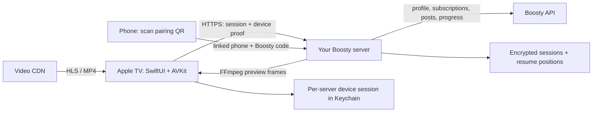

# Boosty for Apple TV

English · [Русский](README.ru.md)

[](https://github.com/staners2/boosty-apple-tv/actions/workflows/ci.yml)
[](project.yml)
[](LICENSE)

Your Boosty subscriptions, on the big screen. An unofficial native Apple TV
client built with **SwiftUI and AVKit**: read complete posts, browse your creators
and watch videos with Siri Remote.

**Bring your own HTTPS server and Boosty account with a linked phone number.**
The server is shared with [Boosty for Samsung TV](https://github.com/staners2/boosty-samsung-tv),
which also provides the PC browser client. This app does not bypass subscriptions.

[Get started](#get-started) · [Install on Apple TV](#install-on-apple-tv) ·
[Controls](#controls) · [Development](docs/development.md) ·
[Samsung / PC / server](https://github.com/staners2/boosty-samsung-tv)


## Features

- Creator subscriptions and a newest-first feed with automatic pagination.
- Full posts with text, images, and phone QR codes for links and attachments.
- Native playback, quality selection, chapters and frame previews.
- Segmented chapter timeline with titles and descriptions.
- Resume playback, with progress synchronized through your server.
- English and Russian UI; creator content is not translated.
- Per-server device sessions in Keychain; Boosty access tokens stay on your server.

The app targets **tvOS 17+**. A build was installed on a physical Apple TV 4K
(3rd generation); codecs, Siri Remote gestures and upstream media still need
testing on your device. There is no public App Store or TestFlight release link.

## Screenshots

Captured from production views in a tvOS Simulator with fictional creators and
local test data. The test player uses Apple's public HLS example. No private
Boosty account is shown.

| Post reader | Chapters and timeline |
| --- | --- |
|  |  |

## How it works



This repository contains the **tvOS client only**. Docker, Helm, persistent
storage, encryption keys and runtime variables belong to the
[server repository](https://github.com/staners2/boosty-samsung-tv#how-it-works).
One server can serve Apple TV, Samsung TV and a PC browser.

## Get started

### 1. Set up the server

Follow the server's [Docker Compose](https://github.com/staners2/boosty-samsung-tv#docker-compose)
or [Kubernetes / Helm](https://github.com/staners2/boosty-samsung-tv#kubernetes--helm)
instructions. Use a trusted HTTPS certificate and a hostname reachable from both
Apple TV and your phone.

For example, `PUBLIC_URL=https://tv.example.org` and `BASE_PATH=/reader` on the
server mean entering **`https://tv.example.org/reader`** in the app. With an empty
`BASE_PATH`, enter just `https://tv.example.org`.

Check `<server-address>/health`: it must return JSON with `"status":"ok"`, not
an HTML page from another service. No server address or deployment secret is
hardcoded in the client. HTTP and invalid TLS certificates are rejected.

### 2. Build the client

You need macOS, full Xcode with tvOS support, and XcodeGen 2.46+. Local checks used
Xcode 27.1; CI uses Xcode from GitHub's macOS 26 runner. There are no third-party
Swift package dependencies.

```sh
git clone https://github.com/staners2/boosty-apple-tv.git
cd boosty-apple-tv
brew install xcodegen
./scripts/test.sh
./scripts/build.sh simulator
open BoostyAppleTV.xcodeproj
```

Select **BoostyAppleTV** and an Apple TV simulator, then Run. Scripts default to
`/Applications/Xcode.app/Contents/Developer`; set `DEVELOPER_DIR` for another
installation. Install missing tvOS platform support in Xcode Settings.

### 3. Connect your account

1. Enter the full HTTPS server address, including any configured base path.
2. Scan the pairing QR with your phone and follow the server's sign-in page.
3. Use the phone number linked to your subscribed Boosty account and enter the
   code on your phone. Google users must first link a phone number to that same
   account; the app never asks for a Google password.
4. Confirm the displayed profile on Apple TV.

Never share active QR codes, pairing links, session cookies or device proofs.
If Keychain storage fails, the app warns that the session is temporary.

## Install on Apple TV

1. Pair Apple TV with Xcode using its device management window and complete the
   TV's development setup prompts. See Apple's
   [device setup guide](https://developer.apple.com/documentation/xcode/running-your-app-on-simulated-or-physical-devices).
2. Sign in to your Apple Account in Xcode. In **Signing & Capabilities**, select
   your own team and automatic signing.
3. The default bundle ID is `org.boostytv.appletv`. If you need your own,
   change `APP_BUNDLE_IDENTIFIER` in `project.yml`, then rerun
   `./scripts/generate.sh` and configure your team in Xcode again if needed.
4. Select your physical Apple TV as the destination and Run.

`./scripts/build.sh device` makes an **unsigned compatibility build**, not an
installable app. Device installation requires your own signing assets. No
certificates, team IDs, profiles or device identifiers are shipped.

When updating an existing installation, keep its original bundle ID to preserve
the app identity and Keychain session namespace. You can override the default
without editing tracked files: `APP_BUNDLE_IDENTIFIER=org.example.boosty ./scripts/build.sh archive`.
Use your actual previous ID and supply `DEVELOPMENT_TEAM` for an archive.

### Your own TestFlight distribution

TestFlight requires Apple Developer Program membership and an App Store Connect
app record. Follow Apple's current
[distribution requirements](https://developer.apple.com/documentation/xcode/distributing-your-app-for-beta-testing-and-releases/).
Create an archive with your team:

```sh
DEVELOPMENT_TEAM=YOUR_TEAM_ID ./scripts/build.sh archive
```

Replace `YOUR_TEAM_ID` with your actual team ID. In Xcode Organizer, validate the
archive and choose **Distribute App → App Store Connect**. After processing and
any required review, add testers in App Store Connect and install TestFlight on
Apple TV. No invitation code or pre-signed IPA is provided by this repository.

## Controls

| Action | Siri Remote / app |
| --- | --- |
| Browse | Directional controls and Select; long posts scroll as focus moves. |
| Back | Parent screen; at the feed or server setup, Apple TV Home without signing out. |
| Play / pause / seek | Native tvOS video controls. |
| Quality, chapters, frame previews | Open **Video controls** in the native player controls panel. |
| Language | Profile → Language. AVKit controls follow the tvOS system language. |
| Change server | Profile → **Disconnect from server**, then confirm. |
| Remove account session | Profile → **Sign out**, which also requests server-side revocation. |

A selected chapter or timeline position shows a cached or requested frame with
its actual timestamp. Confirm to seek; Back cancels selection. Quality changes
preserve position and pause state. Returning from a post restores the selected
feed card and loaded pages.

## Progress, privacy and limitations

Progress is sent about every 15 seconds of position change and on pause,
backgrounding and player close. The shared server keeps a bounded, encrypted
resume cache for up to 24 hours. Video files are **not** cached for offline use.
Failed writes show a warning; there is no persistent offline upload queue after
app termination.

Frames are cached in memory for up to five minutes within the current post
session, with a 32-frame / 4 MiB limit. Nearby positions are prefetched. Missing
previews do not disable seeking. AVPlayer receives HLS and HTTPS progressive
sources, not DASH; codec compatibility depends on the device.

The unofficial Boosty API can change. Paid posts require the corresponding
subscription. This project is not affiliated with Boosty or Apple.

Publication checks passed unit tests and the simulator build, but the latest UI
suite passed 10/11: the player test timed out on readiness/playback of Apple's
external HLS sample. See [verification details](docs/development.md#publication-verification);
do not treat the earlier 11/11 baseline as a current full-suite pass.

## Development and support

See [development and verification](docs/development.md), the
[feature matrix](docs/samsung-parity.md) and [contribution guide](CONTRIBUTING.md).
Use the [bug report form](https://github.com/staners2/boosty-apple-tv/issues/new?template=bug_report.yml)
for reproducible problems. Server deployment and Samsung/PC issues belong in the
[server repository](https://github.com/staners2/boosty-samsung-tv/issues).
Read [SECURITY.md](SECURITY.md) before sharing logs or reporting a vulnerability.

## License

[MIT](LICENSE) · Copyright (c) 2026 staners2.
