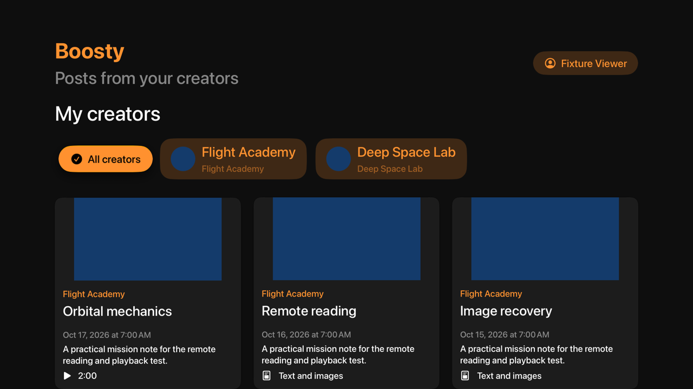
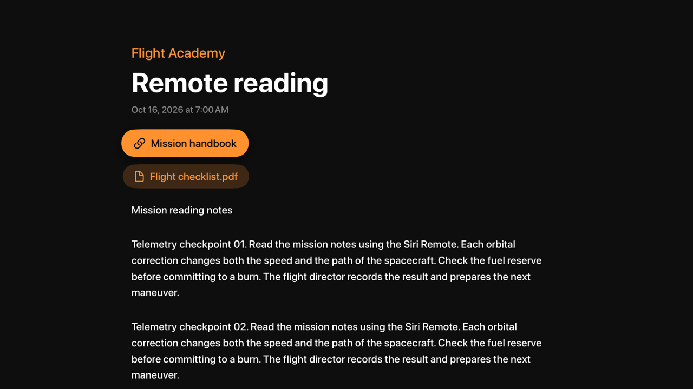
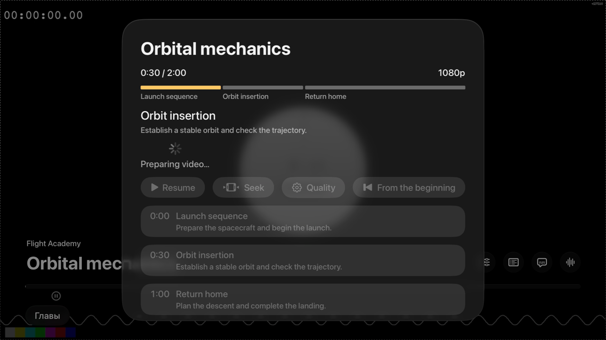
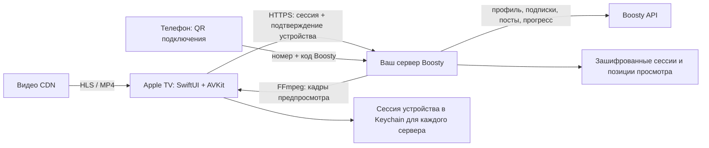

# Boosty для Apple TV

Русский · [English](README.md)

[](https://github.com/staners2/boosty-apple-tv/actions/workflows/ci.yml)
[](project.yml)
[](LICENSE)

Ваши подписки Boosty на большом экране. Неофициальный нативный клиент tvOS на
SwiftUI и AVKit: полные посты, ленты авторов и видео с управлением Siri Remote.

Нужны **собственный HTTPS-сервер** и **аккаунт Boosty с привязанным номером и
доступом к нужным публикациям**. Приложение не обходит подписки. Общий сервер,
клиент Samsung TV и браузера ПК находятся в
[boosty-samsung-tv](https://github.com/staners2/boosty-samsung-tv).

[Подготовка](#подготовка-и-сборка) · [Установка на Apple TV](#установка-на-устройство-и-testflight) ·
[Управление](#навигация) · [Разработка](docs/development.md)



Приложение переносит функционал Samsung-клиента на Apple TV: QR-вход с подтверждением профиля, EN/RU, каталог авторов, лента с автоподгрузкой, полный reader, QR ссылок и файлов, главы с кадрами предпросмотра, нативный плеер со сменой качества, перемоткой и сохранением позиции. Подробная сверка — [матрица функций](docs/samsung-parity.md).

Cookie сессии и подтверждение устройства хранятся в Keychain отдельно для каждого полного адреса сервера. Токены Boosty остаются на сервере. При недоступности Keychain подтверждённый вход работает до закрытия приложения с явным предупреждением. Целевая версия — tvOS 17+. Сборка установлена на Apple TV 4K третьего поколения; совместимость кодеков и жестов нужно проверять на своём устройстве. Публичной ссылки App Store или TestFlight сейчас нет.

## Скриншоты

Снимки сделаны в tvOS Simulator на настоящих экранах приложения с вымышленными
авторами и локальными тестовыми данными. Плеер использует публичный HLS-пример
Apple. Личный аккаунт Boosty не показан.

| Чтение поста | Главы и таймлайн |
| --- | --- |
|  |  |

## Как это работает



Здесь находится **только tvOS-клиент**. Разверните общий сервер по инструкции
[Docker Compose](https://github.com/staners2/boosty-samsung-tv/blob/main/README.ru.md#docker-compose)
или [Kubernetes / Helm](https://github.com/staners2/boosty-samsung-tv/blob/main/README.ru.md#kubernetes--helm).
Один сервер подходит для Apple TV, Samsung TV и браузера ПК.

Серверные `PUBLIC_URL=https://tv.example.org` и `BASE_PATH=/reader` означают
адрес `https://tv.example.org/reader` в приложении. При пустом `BASE_PATH`
вводите только `https://tv.example.org`. Адрес должен быть доступен с телевизора
и телефона, с доверенным сертификатом. `<адрес-сервера>/health` должен возвращать
JSON со `"status":"ok"`, не HTML другого сервиса. Адрес не зашит в приложение.

## Подготовка и сборка

Нужны macOS, полный Xcode с платформой tvOS и XcodeGen 2.46+. Локальные проверки
выполнены на Xcode 27.1; CI использует Xcode из образа macOS 26 GitHub Actions.
Для TestFlight сверяйтесь с актуальными [требованиями Apple](https://developer.apple.com/news/upcoming-requirements/).

```sh
git clone https://github.com/staners2/boosty-apple-tv.git
cd boosty-apple-tv
brew install xcodegen
./scripts/test.sh
./scripts/build.sh simulator
./scripts/build.sh device
```

Скрипты используют `/Applications/Xcode.app/Contents/Developer`. Для другой установки задайте `DEVELOPER_DIR`. Недостающую платформу tvOS установите в настройках Xcode. Внешних зависимостей Swift Package нет.

`./scripts/generate.sh` создаёт проект `BoostyAppleTV.xcodeproj`, многослойную иконку и Top Shelf изображения. Источники генерации — `project.yml` и `scripts/generate-assets.swift`. Генерируемые файлы исключены из Git; редактируйте исходники генераторов.

Откройте полученный проект в Xcode, выберите схему **BoostyAppleTV** и симулятор Apple TV. В приложении введите полный HTTPS-адрес broker, включая base path, если сервер использует его. Сертификат должен быть доверенным; отключения проверки TLS нет.

Проверки API и состояния запускаются через `./scripts/test.sh`. **Product → Test** основной схемы проверяет запуск; сценарии с контентом требуют локального fixture broker:

```sh
# Дополнительно для генерации тестового видео
brew install ffmpeg
# На уже запущенном симуляторе tvOS
UI_FIXTURE_HOST=1 ./scripts/test-ui.sh CODE_SIGNING_ALLOWED=NO -parallel-testing-enabled NO
```

`UI_FIXTURE_HOST=1` собирает отдельную схему **BoostyParity** из `project-fixtures.yml`. Она использует те же production views и AppModel, тестовый HTTPS broker и доверие только к его конкретному CA с проверкой hostname. Тестовый код не входит в основную сборку. AVPlayer в этом режиме играет публичный пример HLS Apple. Без этого флага скрипт проверяет основное приложение с импортом CA только в симулятор; в tvOS Simulator 27 этот импорт может зависать, скрипт ограничивает ожидание 30 секундами. Mac trust store не меняется. Результаты сохраняются в `build/ParityTests-*.xcresult`.

Для первой авторизации отсканируйте QR-код телефоном и выполните вход на странице сервера. После появления профиля подтвердите его на телевизоре. Сам код Boosty или пароль на Apple TV вводить не нужно.

## Навигация

Back возвращает к родительскому экрану, а из ленты или выбора сервера — на домашний экран Apple TV, без отключения от Boosty и сброса сессии.

Для выбора другого сервера откройте профиль → **Отключиться от сервера** и подтвердите переход к вводу адреса. **Выйти из аккаунта** — отдельный пункт профиля, который удаляет сохранённую сессию и запрашивает её отзыв на сервере.

## Плеер

Используется системный `AVPlayerViewController`: перемотка, жесты Siri Remote, пауза и другие доступные функции предоставляет tvOS. HLS и HTTPS progressive-видео передаются в AVPlayer; DASH исключается из списка. Совместимость конкретного кодека требует проверки на приставке.

Перед запуском клиент обновляет публикацию и получает позицию через `/api/progress`. При временной ошибке используется доступная позиция; отказ доступа или повреждённый ответ не заменяются устаревшими данными. Один User-Agent используется в API и медиаплеере.

Действие «Управление видео» в системной панели плеера открывает качество, главы, шкалу и перемотку. При скрытии системных контролов видео остаётся без постоянных кнопок поверх кадра. Смена качества сохраняет текущую позицию и паузу. При выборе позиции ±10 секунд переход выполняется после подтверждения; Back отменяет выбор. Кадр и описание главы обновляются при фокусе, точное время показанного кадра подписано. Если preview недоступен, перемотка остаётся доступной. После конца видео можно начать заново. Ошибка воспроизведения позволяет обновить подписанную ссылку. Системные элементы AVKit используют язык tvOS, собственные панели — выбранный EN/RU.

Общий cache кадров сохраняется между reader и плеером в пределах публикации: TTL 5 минут, до 32 кадров/4 MiB. Повторный выбор отменяет устаревший запрос, а соседние позиции подгружаются заранее. Выход из видео сохраняет загруженные страницы, автора и элемент навигации.

Позиция отправляется в broker после изменения примерно на 15 секунд, при паузе, переходе в фон и выходе из плеера. Запросы сохранения выполняются последовательно. Если отправка не удалась, плеер показывает предупреждение. Офлайн-видео и локальная очередь прогресса после завершения приложения пока не реализованы.

## Установка на устройство и TestFlight

1. Войдите в Apple Account в Xcode и выберите свою команду в **Signing & Capabilities**. Bundle ID по умолчанию: `org.boostytv.appletv`; при необходимости задайте собственный `APP_BUNDLE_IDENTIFIER` в `project.yml`.
2. В Xcode 27 откройте **Xcode → Open Developer Tool → Device Hub**, нажмите **+ → Pair Nearby Device…** и выберите Apple TV. Следуйте инструкциям сопряжения и включения режима разработки, затем запустите схему на приставке. [Инструкция Apple](https://developer.apple.com/documentation/xcode/managing-your-simulated-and-physical-devices-in-device-hub).
3. Для TestFlight требуется действующее членство Apple Developer Program, доступ к App Store Connect, запись приложения и профиль подписи. Публичного приглашения и подписанного IPA в этом репозитории нет.
4. Создайте подписанный архив: `DEVELOPMENT_TEAM=YOUR_TEAM_ID ./scripts/build.sh archive`, заменив `YOUR_TEAM_ID` реальным Team ID. Либо выберите **Product → Archive** в Xcode.
5. В Organizer выберите архив, выполните **Validate App**, затем **Distribute App → App Store Connect**. После обработки сборки добавьте её в TestFlight и установите TestFlight на Apple TV.

Transporter — дополнительный способ загрузить уже экспортированный `.ipa`; для отправки из Organizer он не обязателен. Данные входа, ключи `.p8`, сертификаты и профили не добавляйте в Git.

`./scripts/build.sh device` создаёт неподписанную сборку для проверки SDK, не
устанавливаемое приложение. Для физической приставки нужна ваша подпись.

Для обновления существующей установки сохраняйте её прежний Bundle ID: от него
зависят идентичность приложения и пространство сессии Keychain. Переопределение
без правки отслеживаемых файлов: `APP_BUNDLE_IDENTIFIER=org.example.boosty ./scripts/build.sh archive`.
Укажите настоящий прежний ID и `DEVELOPMENT_TEAM` для архивной сборки.

## Структура

- `Sources/BoostyCore` — контракт существующего broker, HTTPS, cookie/proof и сериализация.
- `Tests/BoostyCoreTests` — проверки запросов и ответов на границе URLSession.
- `Tests/BoostyAppStateTests` — проверки настоящих AppModel, очереди прогресса и контроллера плеера при задержках, отмене и смене сессии.
- `App` — SwiftUI, Keychain и AVKit.
- `UITests` — запуск и сценарии с настоящими production views через Siri Remote в симуляторе.
- `UITests/Fixtures`, `project-fixtures.yml` — отдельный тестовый host, HTTPS broker и медиа для UI-проверок.
- `scripts` — воспроизводимая генерация и сборка.
- `docs/development.md` — команды и границы автоматических проверок.

Backend и Samsung/ПК-клиент разрабатываются в [отдельном репозитории](https://github.com/staners2/boosty-samsung-tv).

## Текущие ограничения проверки

17 октября 2026 на Xcode 27.1 (27A9275), tvOS SDK 27.0 и runtime tvOS Simulator 27 прошли 105 unit-тестов: API, смена сессии, отмена запросов, пагинация, локализация, очередь прогресса, cache кадров, состояние плеера, деление длинного текста без потери содержимого и метаданные глав.

Основная схема `BoostyAppleTV` успешно собрана для tvOS Simulator и подписана для физической Apple TV. Проверка подписи `codesign --verify --deep --strict` прошла.

Ранее все 11 UI-тестов прошли на Apple TV 4K Simulator: setup, отклонение HTTP, QR ссылок/файлов, автоподгрузка и возврат, плеер и главы, EN/RU, длинные посты, Back → Home и явное отключение через профиль. При повторной проверке очищенного кода перед публикацией прошли 10 из 11: сценарий плеера не дождался готовности или запуска внешнего HLS-примера Apple; отдельный повтор также завершился ошибкой. Причина не установлена. Это ограничение проверки, а не подтверждение работы реального CDN Boosty. Подробности — в [development.md](docs/development.md#publication-verification).

В журнале UI остаются системное предупреждение AVAudioSession о синхронной активации и ошибка сбора дополнительных diagnostics Xcode (`xcrun: unable to find utility simctl` при глобальном выборе CommandLineTools). Они не помешали выполнению тестов; снимки экранов сохранены самими тестами. Скрипты явно выбирают установленный полный Xcode.

Подпись и обновление на физической Apple TV до версии 0.1.2 (3) подтверждены. Проверка с настоящим аккаунтом, воспроизведение с CDN, ручная проверка пульта на физической Apple TV и загрузка TestFlight не входят в выполненные автоматические проверки.

## Поддержка и участие

Используйте [форму ошибки](https://github.com/staners2/boosty-apple-tv/issues/new?template=bug_report.yml)
и указывайте модель Apple TV, версии tvOS/Xcode, сборку и действия пультом.
Не прикладывайте токены, cookie, номера телефонов, активные QR и подписанные
ссылки на видео. См. [правила участия](CONTRIBUTING.md) и [SECURITY.md](SECURITY.md).
Проблемы сервера, Docker/Helm и Samsung/ПК направляйте в
[репозиторий сервера](https://github.com/staners2/boosty-samsung-tv/issues).

Приложение использует неофициальный API, который может изменяться. Проект не
связан с Boosty или Apple. Видео не загружаются для офлайн-просмотра; сервер
хранит зашифрованный кэш позиций продолжения до 24 часов.

## Лицензия

[MIT](LICENSE) · Copyright (c) 2026 staners2.
